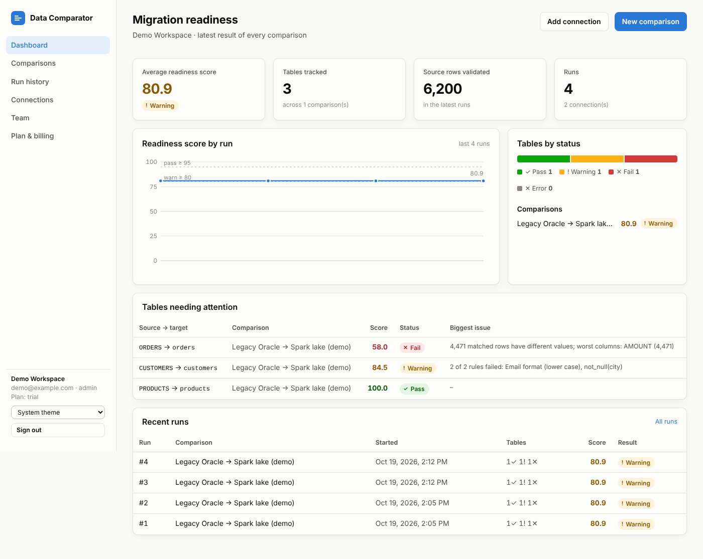
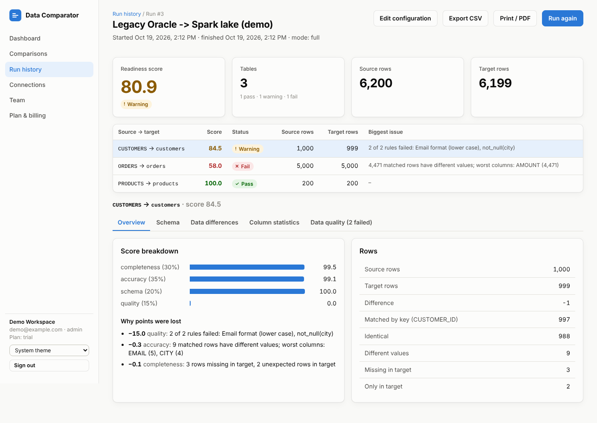
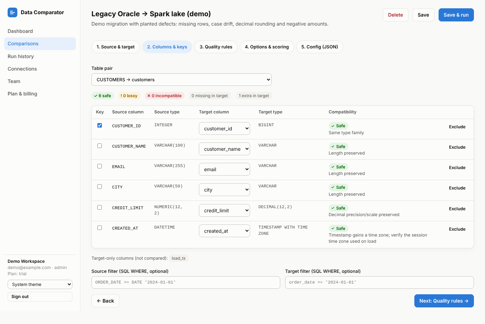
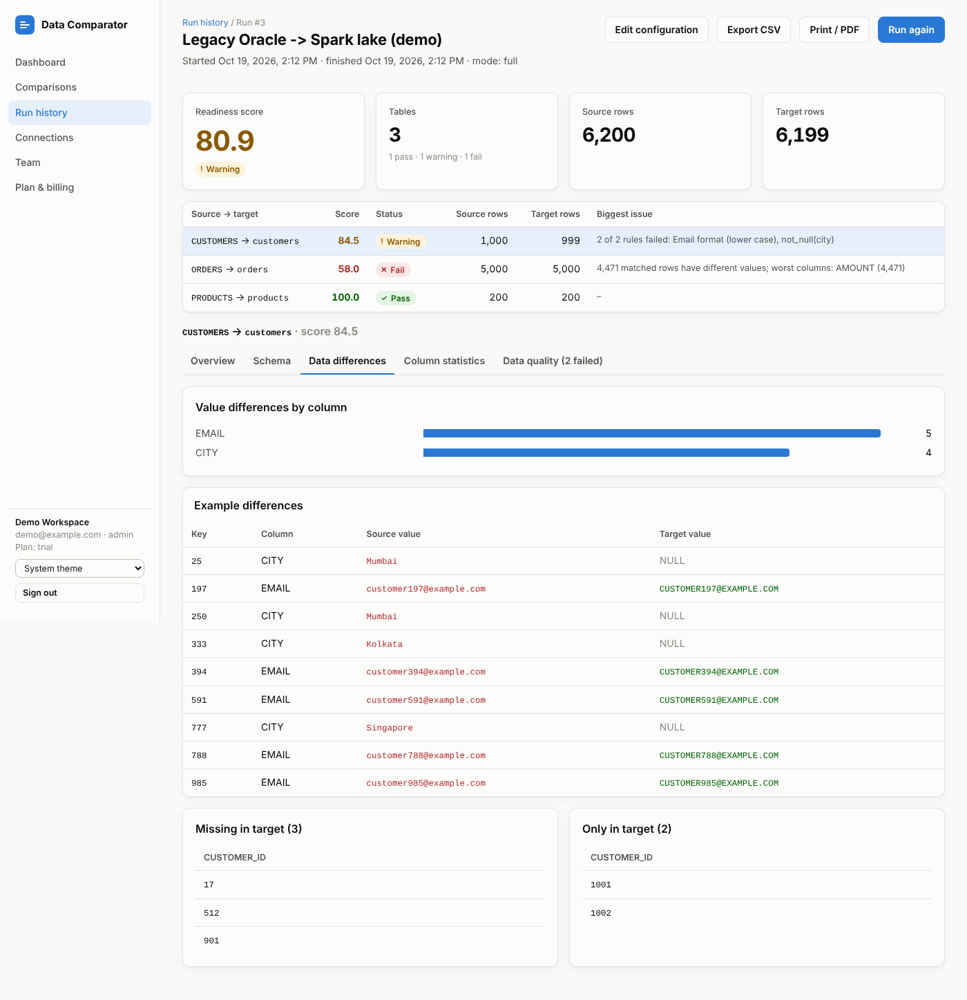

# Data Comparator

A subscription SaaS for **data migration validation** across big-data and cloud platforms.
Point it at any source and any target (Oracle → Spark Parquet, Hive → Databricks,
Redshift → Databricks, Oracle → Snowflake, Snowflake → Databricks, ...) and it answers the
questions every migration team has to sign off on:

| Question | What the tool checks |
|---|---|
| Is the schema compatible? | Column auto-mapping (exact / case / similar names / manual), type compatibility per column: **safe / lossy / incompatible** with the reason (e.g. *"Scale reduced from 2 to 1; values will be rounded"*), missing and extra columns, nullability |
| Did every row arrive? | Row counts (pushed down), key-based matching: rows missing in target, unexpected rows in target, duplicate / NULL keys |
| Did the values survive? | Row-level diff by key with normalisation (CHAR padding, case, `'' = NULL`, numeric tolerance, timestamp precision, time zones), per-column mismatch counts and side-by-side examples. Row-hash comparison when no key exists |
| Same data without moving it? | Column statistics (nulls, distinct, min, max, sum) computed **inside** each engine and compared |
| Is the data good? | Data quality rules: not null, unique, range, regex, allowed values, max length, custom SQL expressions, each with severity and tolerated % |
| Can we go live? | One explainable **readiness score (0–100)** per table and per run, with weights and pass/warn thresholds you configure and a list of exactly why points were lost |

Everything is configured from the UI (connections, table pairs, keys, column mappings, filters,
rules, tolerances, weights). Each comparison is also a single JSON document, so it can be kept
in Git and run from CI/CD through the REST API.

| Dashboard | Run report |
|---|---|
|  |  |
| **Column mapping & type compatibility** | **Value differences** |
|  |  |

---

## Quick start (local evaluation)

### Option A: Docker (recommended)

```bash
docker compose up --build
```

Open **http://localhost:3000** and sign in with the demo account **`demo@example.com` / `demo1234`**.
The demo workspace contains a legacy database (Oracle-style naming, as SQLite) migrated to a
Spark-style partitioned Parquet lake with planted defects: missing and extra rows, upper-cased
emails, lost cities, `DECIMAL(12,2) → DECIMAL(10,1)` rounding and negative amounts. Open
*Comparisons → Run now* to see them all detected.

The image includes the drivers for Oracle, Snowflake, Databricks, Redshift, Hive/Spark Thrift,
BigQuery, Teradata, PostgreSQL and MySQL. To compare local files, put them in the `data`
volume (mounted at `/data`).

### Option B: run from source

```bash
# backend (Python 3.11+)
cd backend
python -m venv .venv && . .venv/bin/activate
pip install -r requirements-dev.txt
pip install -r requirements-connectors.txt   # optional: drivers for real databases
uvicorn app.main:app --reload --port 8000

# web UI (Node 20+), in another terminal
cd frontend
npm install
npm run dev        # http://localhost:3000, proxies /api to :8000
```

Tests: `cd backend && pytest` · Lint: `ruff check app tests` · UI types: `cd frontend && npm run typecheck`

---

## Supported systems

Any source can be compared with any target. Every native type is translated into one
canonical type system, so the engine has no per-pair code.

| Category | Systems |
|---|---|
| Cloud warehouses | Snowflake, Amazon Redshift, Google BigQuery |
| Big data | Databricks (Unity Catalog / Hive metastore, Delta), Apache Hive, Spark Thrift Server |
| Databases | Oracle, Teradata, SQL Server / Azure Synapse, PostgreSQL, MySQL/MariaDB, SQLite |
| Files / data lake | Parquet (Spark/Hive partitioned folders), CSV, JSON, Delta Lake, Iceberg on local disk, S3, ADLS/Azure Blob, GCS |
| Anything else | Any engine with a SQLAlchemy dialect (Trino/Presto, Db2, Vertica, ...) |

## How a comparison runs

```
for each table pair
  1. schema      read both column lists → map columns → classify each type pair
  2. counts      COUNT(*) on both engines (with optional WHERE filters)
  3. profile     nulls / distinct / min / max / sum per column, in each engine   (profile mode)
  4. row diff    stage both sides into a sandboxed DuckDB → normalise → FULL OUTER JOIN on key   (full mode)
                 large tables: first N rows by key on the source + the same key range on the target
  5. quality     rules evaluated on the staged rows
  6. score       weighted completeness / accuracy / schema / quality → 0-100 + deductions
```

Three depths per comparison: **counts** (metadata only), **profile** (pushdown statistics, no
data movement, good for billion-row tables), **full** (row-level diff).

### Readiness score

| Component | Measures | Default weight |
|---|---|---|
| Completeness | rows matched by key ÷ all keys on either side (or the row-count ratio) | 30 |
| Accuracy | matched rows with identical values (or matching column statistics) | 35 |
| Schema | safe = 1, lossy = 0.5, incompatible or missing = 0, averaged over source columns | 20 |
| Quality | passed rules, weighted by severity (low 1, medium 2, high 3) | 15 |

Components that were not measured (e.g. no rules configured) are left out and the other
weights rebalanced. Default thresholds: **pass ≥ 95**, **warning ≥ 80**, otherwise fail.

### Comparison config (JSON)

```json
{
  "source_connection_id": 1,
  "target_connection_id": 2,
  "tables": [
    {
      "source_table": "SALES.ORDERS",
      "target_table": "main.sales.orders",
      "key_columns": ["ORDER_ID"],
      "column_mappings": [{"source": "CUST_NO", "target": "customer_id"}],
      "exclude_columns": ["ROW_VERSION"],
      "source_filter": "ORDER_DATE >= DATE '2024-01-01'",
      "target_filter": "order_date >= '2024-01-01'",
      "rules": [
        {"type": "range", "column": "amount", "min": 0, "severity": "high"},
        {"type": "expression", "expression": "ship_date >= order_date", "max_violation_pct": 0.1}
      ]
    }
  ],
  "options": {
    "mode": "full",
    "max_rows": 1000000,
    "normalization": {"trim_strings": true, "null_equals_empty": true, "numeric_tolerance": 0.01},
    "weights": {"completeness": 30, "accuracy": 35, "schema": 20, "quality": 15},
    "thresholds": {"pass_score": 95, "warn_score": 80}
  }
}
```

### CI/CD gating (REST API)

```bash
TOKEN=$(curl -s -X POST $APP/api/auth/login -H 'Content-Type: application/json' \
  -d '{"email":"ci@acme.com","password":"..."}' | jq -r .token)
RUN=$(curl -s -X POST $APP/api/jobs/42/run -H "Authorization: Bearer $TOKEN" | jq .id)
# poll until finished, then fail the pipeline below the threshold
curl -s $APP/api/runs/$RUN -H "Authorization: Bearer $TOKEN" | jq -e '.result.summary.status == "pass"'
```

Interactive API docs: `/api/docs`.

---

## Subscriptions

Plans and limits live in `backend/app/plans.py`: users, connections, comparisons, tables per
comparison, rows per table for row-level diffs, runs per month, quality rules, API access.
New sign-ups start on a 14-day **trial** (Team features). Usage (runs, rows compared) is metered
per organisation and month.

* **Evaluation mode** (default, `BILLING_ENABLED=false`): admins can switch plans freely on
  *Plan & billing* to try the limits.
* **Live billing**: create a product with monthly prices in Stripe, then set

  ```
  BILLING_ENABLED=true
  STRIPE_SECRET_KEY=sk_live_...
  STRIPE_WEBHOOK_SECRET=whsec_...         # webhook endpoint: https://app.yourdomain.com/api/billing/webhook
  STRIPE_PRICE_TEAM=price_...
  STRIPE_PRICE_BUSINESS=price_...
  APP_URL=https://app.yourdomain.com
  ```

  *Subscribe* opens Stripe Checkout; the webhook (`checkout.session.completed`,
  `customer.subscription.updated/deleted`) activates or downgrades the plan.

## Linking it to your existing website

The comparator is an independent app, so you can test it on its own and connect it later
without changing your website's technology:

1. Deploy it on a subdomain, e.g. `app.yourdomain.com` (any container platform: AWS ECS / App
   Runner, Azure Container Apps, Google Cloud Run, Kubernetes, or a VM with `docker compose`).
2. On your website add a product page and two buttons:
   `Start free trial → https://app.yourdomain.com/register` and
   `Sign in → https://app.yourdomain.com/login`.
3. Optional: render the pricing table on your website from the public endpoint
   `GET https://app.yourdomain.com/api/billing/plans` (set `CORS_ORIGINS=https://yourdomain.com`).

## Production checklist

* Set a long random `SECRET_KEY` and a separate `ENCRYPTION_KEY` (Fernet key, encrypts connection
  passwords at rest). Changing `ENCRYPTION_KEY` makes stored secrets unreadable.
* Use PostgreSQL for `DATABASE_URL` (as in `docker-compose.yml`); `SEED_DEMO=false`.
* Serve over HTTPS behind a load balancer; restrict `CORS_ORIGINS`.
* `DATA_ROOT` is the only local folder the file and SQLite connectors may read; cloud paths
  (S3/ADLS/GCS) use the credentials stored on the connection.
* Size the worker for the staged row-level diffs: memory and disk scale with
  `max_rows` × columns. `MAX_WORKERS` sets concurrent runs per instance.

## Configuration reference

| Variable | Default | Purpose |
|---|---|---|
| `DATABASE_URL` | `sqlite:///backend/var/app.db` | Metadata store (users, connections, runs) |
| `SECRET_KEY` | dev value | Signs session tokens; derives the encryption key if `ENCRYPTION_KEY` is unset |
| `ENCRYPTION_KEY` | derived | Fernet key for connection secrets |
| `DATA_ROOT` | `./sample_data` | Folder readable by file/SQLite connectors |
| `WORK_DIR` | `backend/var/work` | Scratch space for staged comparisons |
| `SEED_DEMO` | `true` | Create the demo workspace on an empty install |
| `DEFAULT_PLAN` | `trial` | Plan for new sign-ups |
| `MAX_WORKERS` | `2` | Concurrent runs per instance |
| `CORS_ORIGINS` | `*` | Allowed browser origins for the API |
| `BILLING_ENABLED`, `STRIPE_*`, `APP_URL` | off | Subscriptions (see above) |

## Project layout

```
backend/app/
  connectors/   one class per system + DuckDB-backed files connector (sandboxed)
  engine/       canonical types, schema compare, data diff, quality rules, scoring, runner
  api/          REST endpoints (auth, connections, jobs/runs, dashboard, billing)
  plans.py      subscription plans and limits
frontend/src/   React UI: dashboard, connections, comparison editor, run reports, billing
```

## Roadmap

* Scheduled runs (cron) and Slack / Teams / email alerts
* Self-hosted execution agent so data never leaves the customer's network (control plane stays SaaS)
* In-database hash bisection for billion-row row-level diffs without staging
* SSO (SAML/OIDC) and audit log export
* AI-assisted column mapping and plain-language explanations of mismatches
